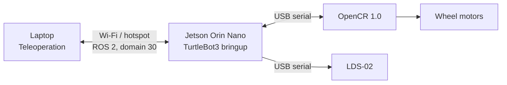

# TurtleBot3 Burger Jetson Orin Nano Guide

Technical guide and operation manual for a TurtleBot3 Burger migrated from a Raspberry Pi 3 to an NVIDIA Jetson Orin Nano. It is intended for project demonstrations: understanding the system, starting the robot-side stack, and teleoperating the robot from a laptop.

> Scope: this repository documents the configuration that has been tested. It does not claim SLAM, Navigation2, or autonomous navigation are operational.

## Objectives

- Record the Jetson migration and the verified robot configuration.
- Explain communication between the Jetson, OpenCR, LDS-02, and laptop.
- Provide a repeatable bringup and keyboard-teleoperation procedure.
- Provide focused checks for common demonstration issues.

## System at a Glance

| Area | Verified configuration |
| --- | --- |
| Robot | TurtleBot3 Burger |
| Robot-side computer | NVIDIA Jetson Orin Nano |
| Original computer | Raspberry Pi 3 (replaced) |
| Motor controller | OpenCR 1.0 |
| LiDAR | LDS-02 |
| Robot and laptop OS | Ubuntu 22.04.5 |
| ROS distribution | ROS 2 Humble |
| ROS domain | `30` |
| TurtleBot model | `burger` |
| Network | Laptop hotspot (used in testing) or shared Wi-Fi |
| Powerbank model | TBD |



## Current Achievement

- TurtleBot3 bringup runs on the Jetson.
- OpenCR and LDS-02 have been configured and run successfully.
- ROS 2 communication between laptop and Jetson has been tested.
- Keyboard teleoperation from the laptop moves the robot.

## Documentation

1. [System overview](docs/01-system-overview.md)
2. [System configuration](docs/02-system-configuration.md)
3. [Running TurtleBot3](docs/03-running-turtlebot3.md)
4. [Keyboard teleoperation](docs/04-teleoperation.md)
5. [Troubleshooting](docs/05-troubleshooting.md)

## License

This project is licensed under the [MIT License](LICENSE). Replace the copyright-holder placeholder in the license file with the appropriate owner before publishing.

## Quick Start

On the Jetson, load the saved ROS environment and start the robot stack:

```bash
source ~/.bashrc
export LDS_MODEL=LDS-02
ros2 launch turtlebot3_bringup robot.launch.py
```

On a laptop connected to the same network, use the same ROS domain and run teleoperation:

```bash
source /opt/ros/humble/setup.bash
export ROS_DOMAIN_ID=30
ros2 run turtlebot3_teleop teleop_keyboard
```

See [System Configuration](docs/02-system-configuration.md) for laptop-hotspot, router, external-hotspot, and SSH communication procedures. See [Running TurtleBot3](docs/03-running-turtlebot3.md) before driving the robot.
