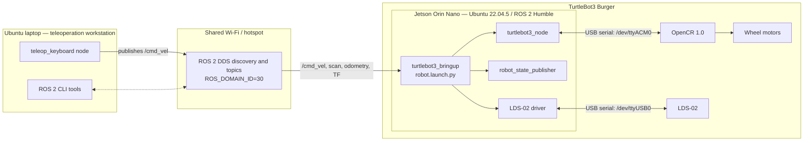

# 01. System Overview

[← README](../README.md) · [Next: System Configuration →](02-system-configuration.md)

## Project Summary

This project replaces the original Raspberry Pi 3 in a TurtleBot3 Burger with an NVIDIA Jetson Orin Nano. The Jetson is the robot-side computer: it runs the TurtleBot3 ROS 2 bringup and communicates by USB serial with the OpenCR motor controller and LDS-02 LiDAR. A separate Ubuntu laptop publishes keyboard teleoperation commands over a wireless network. Laptop hotspot was used in testing; a shared Wi-Fi network is an alternative.

The demonstrated capability is remote teleoperation with robot state and LiDAR data available through ROS 2. Autonomous navigation, SLAM, and Navigation2 are outside the verified scope.

## Why Jetson Orin Nano

The Jetson Orin Nano is used as the new main computer to replace the Raspberry Pi 3. Its role in this project is to provide the Ubuntu 22.04.5 and ROS 2 Humble environment required by the verified TurtleBot3 stack. Detailed Jetson module, memory, storage, and power specifications were not recorded and are **TBD**.

## Hardware and Software

| Category | Component | Function | Status |
| --- | --- | --- | --- |
| Mobile base | TurtleBot3 Burger | Differential-drive robot platform | Verified |
| Main computer | NVIDIA Jetson Orin Nano | Runs ROS 2 bringup and interfaces with peripherals | Verified |
| Previous computer | Raspberry Pi 3 | Original computer, replaced by Jetson | Verified |
| Motor controller | OpenCR 1.0 | Receives velocity commands and controls motors | Verified |
| Range sensor | LDS-02 | Publishes 2D laser scan data | Verified |
| Robot power | Powerbank | Supplies the system | Model TBD |
| Robot OS | Ubuntu 22.04.5 | Jetson operating system | Verified |
| Laptop OS | Ubuntu 22.04.5 | Teleoperation workstation OS | Verified |
| Middleware | ROS 2 Humble | Robot communication framework | Verified |

## Component Responsibilities

- **Jetson Orin Nano:** starts `turtlebot3_bringup`, publishes robot state, and bridges ROS 2 to the connected hardware.
- **OpenCR 1.0:** receives motion commands through the TurtleBot3 driver and operates the wheel motors; it also supplies controller/sensor state used for odometry.
- **LDS-02:** provides laser scan measurements to the ROS 2 graph.
- **Laptop:** runs the keyboard teleoperation node and ROS 2 inspection tools.
- **Wi-Fi/hotspot:** carries ROS 2 discovery and topic traffic between laptop and Jetson.

## Communication Architecture

The shown serial-device paths are the actual defaults in the verified `robot.launch.py`. They must be checked again if USB enumeration changes after a reboot.

## Verified Interfaces

| Source | Destination | Interface | Purpose |
| --- | --- | --- | --- |
| Laptop | Jetson | Laptop hotspot (tested) or shared Wi-Fi, ROS 2 | Teleoperation and observation |
| Jetson | OpenCR | USB serial, default `/dev/ttyACM0` | Motor control and robot state |
| Jetson | LDS-02 | USB serial, default `/dev/ttyUSB0` | Laser scan data |

Continue with [System Configuration](02-system-configuration.md) for the environment variables and verification commands.
